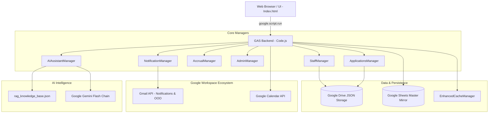

# AgriLeave — Enterprise Leave Management & HR Assistant

[](Code.js)
[](https://developers.google.com/apps-script)
[](https://aistudio.google.com/)
[](Code.js)
[](#license)

> **AgriLeave** is a comprehensive, enterprise-grade Leave Management Web Application built specifically for **Agri Experience Limited**. Powered by **Google Apps Script** and backed by **Google Drive JSON storage** with a real-time **Google Sheets mirror**, AgriLeave automates leave accruals, multi-tier approvals, calendar synchronizations, and features a built-in **floating RAG-based AI Assistant** driven by Google's Gemini Flash model chain.

---

## Table of Contents

- [Key Features](#key-features)
- [System Architecture](#system-architecture)
- [Leave Policies & Entitlements](#leave-policies--entitlements)
- [Year-End Processing & Easter Expiry](#year-end-processing--easter-expiry)
- [Role-Based Access Control (RBAC)](#role-based-access-control-rbac)
- [Floating AI Assistant & Gemini Fallback Chain](#floating-ai-assistant--gemini-fallback-chain)
- [Google Workspace Integrations](#google-workspace-integrations)
- [Data Storage & Persistence Layer](#data-storage--persistence-layer)
- [Setup & Deployment Guide](#setup--deployment-guide)
- [Project File Structure](#project-file-structure)
- [License](#license)

---

## Key Features

- **Automated Monthly Accruals**: Accrues 1.75 days per completed calendar month (21 days/year) automatically on the 1st of each month.
- **Flexible Leave Application Modes**: Supports full-day, multi-day, half-day (0.5 day minimum), and hourly partial-day leaves (1 to 8 hours).
- **Multi-Tier Approval Routing**: Standard leaves ($\le$ 5 days) route to direct supervisors; extended leaves (> 5 days) or specialized types (Study, Maternity, Paternity) require 2-tier approval (Supervisor + HR).
- **Handover Colleague Protocol**: Mandatory handover nominee with an interactive task checklist, automated email notifications, and colleague acceptance/declination workflows.
- **Strict Blackout Periods**: Configurable operational blackout windows (e.g. seasonal agricultural audits, financial year-end) with departmental restrictions and administrative override controls.
- **Gazetted Holiday Calendar**: Full integration with Kenya gazetted public holidays — weekend and holiday days are excluded automatically from leave deductions.
- **Overtime Compensation Leave**: Staff working on approved weekends or public holidays can log compensation claims; approved hours convert directly into non-expiring leave days.
- **Gmail Out-of-Office Integration**: Synchronizes approved leave dates directly with the employee's Gmail Vacation Responder.
- **Google Calendar Synchronization**: Automatically records approved staff absences into Google Calendar.
- **Dual-Store Architecture**: Fast Google Drive JSON file storage combined with a Google Sheets database mirror for external reporting and business intelligence.
- **Floating RAG AI Assistant**: Role-grounded, context-aware chatbot offering instant guidance on balances, policies, and company-wide queries with zero external server costs.

---

## System Architecture



---

## Leave Policies & Entitlements

| Leave Type | Allocation / Entitlement | Rules & Conditions |
| :--- | :--- | :--- |
| **Annual Leave** | 21 working days / year | Accrues monthly at 1.75 days/mo. Requires advance application and supervisor approval. |
| **Sick Leave** | 7 working days / year | Resets annually on January 1st. Consecutive $\ge$ 2 days require a certified medical certificate. |
| **Compensation Leave** | Accrued as earned | Earned via approved weekend/holiday duty claims. Never expires or resets at year-end. |
| **Brought Forward (Carryover)** | Max 21 days | Unused annual leave from previous year. **Expires annually on Easter Sunday**. |
| **Maternity Leave** | 90 calendar days | Fully paid for female employees upon delivery or adoption. |
| **Paternity Leave** | 14 calendar days | Fully paid for male employees upon birth/adoption. |
| **Compassionate Leave** | Up to 5 working days | For demise of immediate family (spouse, child, parent, sibling). |
| **Study Leave** | Discretionary | For recognized professional exams and courses; requires supervisor & HR sign-off. |

---

## Year-End Processing & Easter Expiry

AgriLeave includes a specialized year-end lifecycle engine executed either **automatically on January 1st at 00:30** or manually via the Admin portal (`AdminManager.processYearEnd`):

1. **Annual Leave Carry-Forward**:
   - Calculates net unutilized annual leave position (`accrued - used + deficit`).
   - Carries forward positive net balance up to the **21-day ceiling** into `LeaveBroughtForward`.
   - Any excess beyond 21 days is forfeited.
2. **Dynamic Easter Expiry**:
   - All brought forward days carry an official expiration date dynamically computed to **Easter Sunday of the new year** (`Utils.calculateEasterDate(targetYear)`).
   - Any unused brought forward days are forfeited upon Easter.
3. **Annual Deficit Rollover**:
   - Negative net positions (advance leave taken) are rolled over as an **annual deficit** and recovered progressively from new year monthly accruals (1.75 days/month).
4. **Sick Leave Annual Reset**:
   - Resets back to full allocation of **7 working days** (sick days do not accumulate).
5. **Compensation Leave Preservation**:
   - Compensation balances remain intact and are **never forfeited**.
6. **Audit Trail**:
   - Stamps year guard `yearEndProcessed_${year}` to prevent duplicate runs, logs transition details into `annual_reset_logs.json`, and emails a summary report to HR.

---

## Role-Based Access Control (RBAC)

AgriLeave enforces hard security boundaries on both the frontend UI and GAS backend:

| Role | Permissions & Scope |
| :--- | :--- |
| **Admin** | **Unrestricted, 100% access across the entire organization**. Can manage all staff, adjust balances, execute year-end processing, override blackout dates, inspect audit logs, and query all data via the AI Assistant. |
| **HR** | Company-wide access to all leave analytics, pending approval queues, staff directory, balance recalibrations, gazetted holidays, and policy settings. |
| **Supervisor** | Authority to approve/decline leave applications and view leave balances for **direct reports only**. Access to 30-day team absence forecasts and availability calendars. |
| **Staff** | Restricted strictly to viewing personal balances, applying for leave, managing own applications, viewing public holidays, and company policy information. |

---

## Floating AI Assistant & Gemini Fallback Chain

AgriLeave features a modern floating conversational widget (`#aiChatPanel`) accessible from any page.

### Strict Role Grounding
- **Staff**: Can only ask about their own balances, applications, and general company policies. Colleague inquiries are politely rejected per confidentiality rules.
- **Supervisor**: Accesses direct report balances, pending team applications, and team availability.
- **Admin & HR**: Full clearance to query company-wide analytics, staff balances (e.g., *"What are Denis' balances?"*), pending review queues, and year-end logs.

### Model Priority Fallback Chain
AgriLeave connects to Google AI Studio's free tier with automated failover:

```javascript
GEMINI_MODEL_FALLBACK_CHAIN: [
    'gemini-3.5-flash-lite',
    'gemini-3.5-flash',
    'gemini-3.7-flash',
    'gemini-3.8-flash'
]
```

- **Instant Latency Optimization**: Configured with `thinkingLevel: "low"` to eliminate Google Apps Script gateway connection timeouts. Responses arrive in **1 to 3 seconds**.
- **Self-Healing Fallback**: Automatically tries alternate candidate models if Google servers report `503 UNAVAILABLE` or `429 RATE_LIMIT`.
- **Persistent 404 Cache**: Non-existent endpoints are remembered in Script Properties to avoid repetitive network latency.

---

## Google Workspace Integrations

1. **Google Drive JSON Database**: High-speed, document-oriented persistence without requiring Cloud SQL or external hosting fees.
2. **Google Sheets Master Mirror**: Dual-writes every leave record, balance update, and audit log to a structured Google Sheet for easy export and accounting reconciliation.
3. **Gmail Notifications**: Formats and delivers branded, mobile-responsive HTML email notifications with one-click approval buttons.
4. **Gmail Vacation Responder**: Automatically activates Out-of-Office auto-replies for the duration of approved leaves.
5. **Google Calendar API**: Records approved leave durations directly to staff and organizational calendars.

---

## Data Storage & Persistence Layer

All application data resides inside a designated Google Drive folder (`Agri Experience Leave System`):

```
Agri Experience Leave System/
├── staff_data.json                   # Staff profiles, roles, supervisors, and accruals
├── leave_applications.json           # Active & historical leave applications
├── leave_applications_archive.json   # Archived past-year applications
├── system_settings.json              # System configuration and policy thresholds
├── compensation_claims.json          # Weekend and holiday overtime compensation claims
├── blackout_periods.json             # Departmental restricted leave periods
├── gazetted_holidays.json            # Official public holidays
├── annual_reset_logs.json            # Historical audit logs of year-end processing
├── system_logs.json                  # System audit and error logging
└── rag_knowledge_base.json           # Indexed policy chunks for the AI Assistant
```

---

## Setup & Deployment Guide

### Prerequisites
- A Google Workspace or Gmail account.
- Free Google Gemini API Key from [Google AI Studio](https://aistudio.google.com/).

### Deployment Steps
1. **Create Apps Script Project**:
   - Open [Google Apps Script](https://script.google.com/) and create a new project named **AgriLeave**.
2. **Add Source Files**:
   - Copy the contents of [`Code.js`](Code.js) into the script editor's `Code.gs`.
   - Copy the contents of [`Index.html`](Index.html) into an HTML file named `Index.html`.
3. **Configure Gemini API Key**:
   - In Apps Script, open **Project Settings** ($\text{gear icon}$) $\rightarrow$ **Script Properties**.
   - Add property:
     - **Property**: `GEMINI_API_KEY`
     - **Value**: `Your-Google-AI-Studio-API-Key`
   *(Alternatively, an Admin can click the Key icon in the floating AI Assistant chat widget inside the web app).*
4. **Deploy Web Application**:
   - Click **Deploy** $\rightarrow$ **New Deployment**.
   - Select **Web app**.
   - **Execute as**: `User accessing the web app` (or `Me` depending on organizational deployment model).
   - **Who has access**: `Anyone within your organization` (e.g., `agri-experience.com`).
5. **Initialize System**:
   - Launch the Web App URL.
   - Run initial setup or execute `apiCreateFirstAdmin()` to bootstrap the administrative account.

---

## Project File Structure

```
AgriLeave/
├── Code.js        # Complete backend logic (11,000+ lines: 25 Managers, RBAC, RAG AI, Drive DB)
├── Index.html     # Single-Page UI (14,000+ lines: Tailwind CSS, Chart.js, Modals, AI Chat Panel)
└── README.md      # Comprehensive technical documentation & deployment guide
```

---

## License

Copyright &copy; 2026 **Agri Experience Limited**. All rights reserved.  
Confidential and proprietary software. Unauthorized copying, distribution, or reverse engineering is strictly prohibited.
