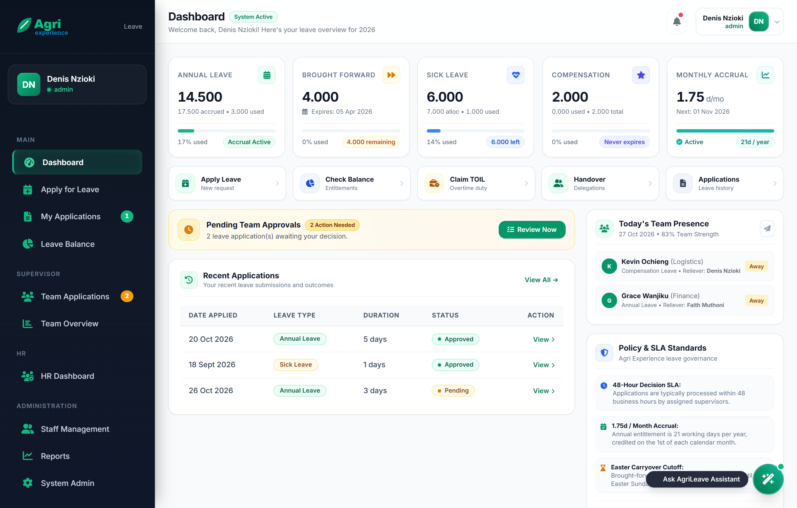
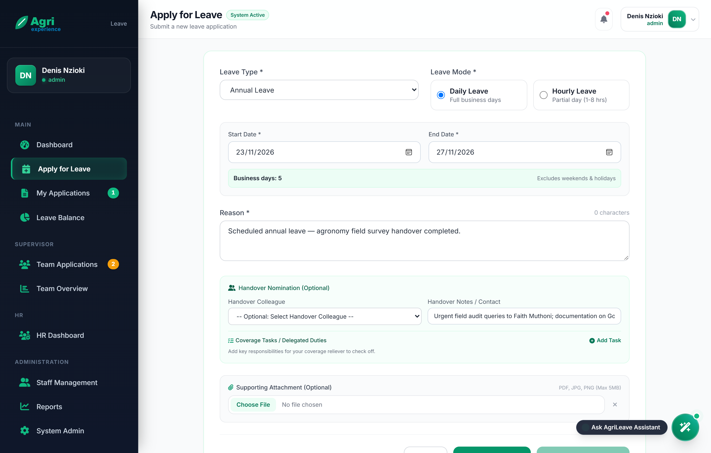
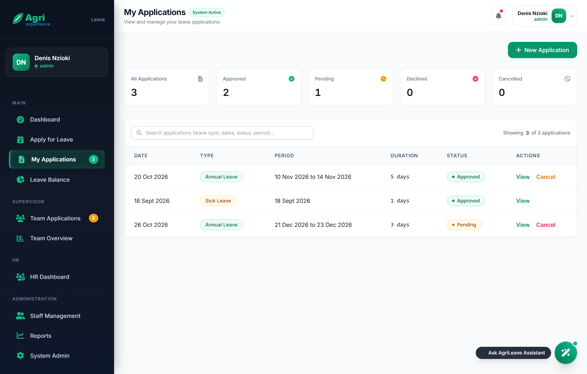
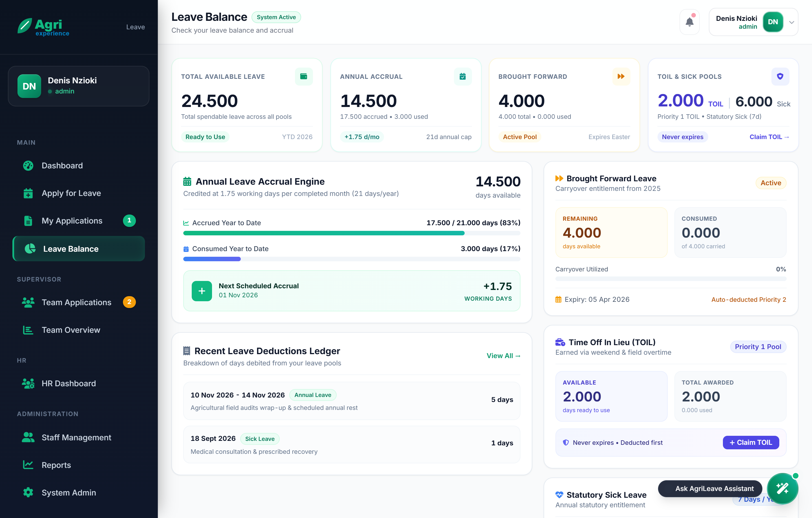
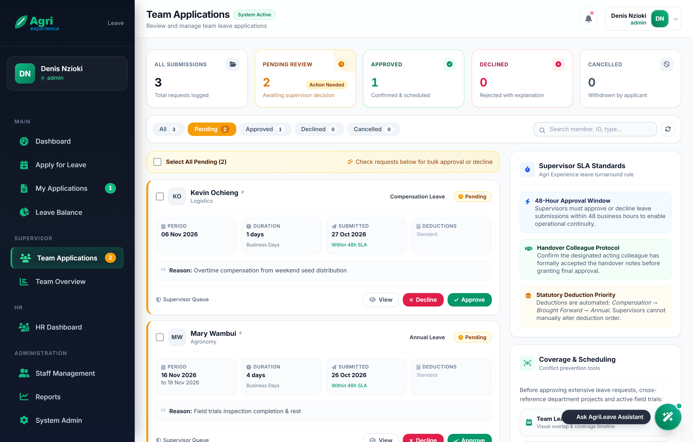
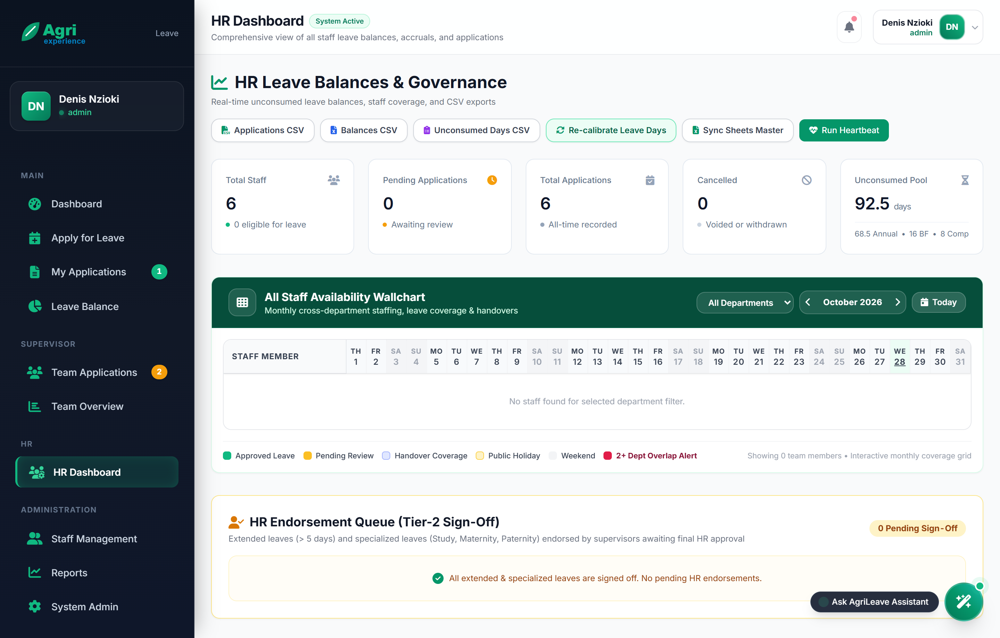
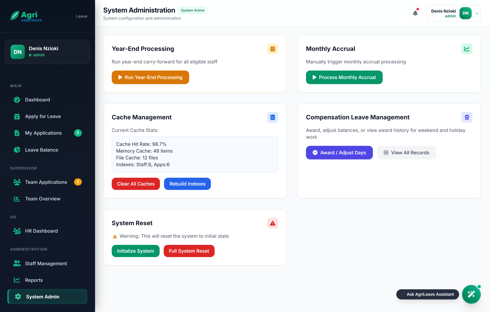
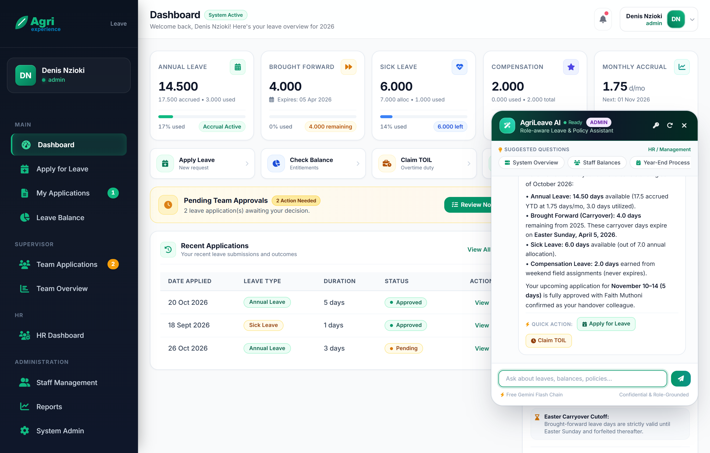

# AgriLeave — Comprehensive System & User Guide
**Agri Experience Limited • Enterprise Leave Management & HR Assistant (v3.4.0)**

---

## 1. System Overview & Architecture

**AgriLeave** is a high-performance leave operations platform engineered specifically for **Agri Experience Limited**. Hosted natively on **Google Apps Script (GAS)**, the application operates entirely within the organization's Google Workspace ecosystem with zero external server infrastructure.

### Core Architecture & Dual-Store Persistence

AgriLeave employs a dual-store architecture to combine ultra-low latency with enterprise-grade reporting:

```
Google Workspace Ecosystem
├── Primary Store: Google Drive JSON Files (Agri Experience Leave System/)
│   ├── staff_data.json                   # Staff profiles, roles, supervisors, and accruals
│   ├── leave_applications.json           # Active & historical leave applications
│   ├── leave_applications_archive.json   # Archived past-year applications
│   ├── system_settings.json              # System configuration and policy thresholds
│   ├── compensation_claims.json          # Weekend and holiday overtime compensation claims
│   ├── blackout_periods.json             # Departmental restricted leave periods
│   ├── gazetted_holidays.json            # Official public holidays
│   ├── annual_reset_logs.json            # Historical audit logs of year-end processing
│   ├── system_logs.json                  # System audit and error logging
│   └── rag_knowledge_base.json           # Indexed policy chunks for the AI Assistant
│
├── Secondary Store: Google Sheets Master Mirror (AgriLeave Master Database & Mirror)
│   ├── Applications                      # Real-time mirror of all application records
│   ├── Staff_Balances                    # Real-time ledger of staff entitlements & balances
│   ├── Gazetted_Holidays                 # Kenya public holidays registry
│   └── Audit_Log                         # Transaction and administrative audit logs
│
├── Workspace Services Integration
│   ├── Gmail API                         # Branded HTML email notifications with 1-click approvals
│   ├── Gmail Vacation Responder          # Automatic Out-of-Office auto-reply activation/deactivation
│   └── Google Calendar API               # Leaves synced to organizational or primary calendars
│
└── AI Assistant Engine (Google AI Studio)
    ├── Fallback Chain                    # gemini-3.5-flash-lite → 3.5-flash → 3.7-flash → 3.8-flash
    └── Embeddings Model                  # text-embedding-004 (RAG knowledge base)
```

---

## 2. Interface Overview: Main Dashboard

The **AgriLeave Dashboard** provides an executive summary of personal balances, team presence, quick operational actions, and recent submission records.


*Figure 1: AgriLeave Executive Dashboard with Leave Cards, Quick Actions & Recent Applications.*

### Key Dashboard Components:
1. **Annual Leave Card**: Displays currently available days, cumulative year-to-date accrual (`accruedYearToDate`), days consumed (`usedYearToDate`), and usage percentage.
2. **Brought Forward (Carryover) Card**: Displays carryover balance from the prior calendar year, indicating remaining days and the dynamic Easter Sunday expiry date (`Expires: 05 Apr 2026`).
3. **Sick Leave Card**: Displays remaining sick days against the statutory allocation of 7.0 working days.
4. **Compensation Days (TOIL)**: Non-expiring days earned from approved weekend or holiday duty claims (`compensationBalance`).
5. **Monthly Accrual Progress**: Shows the monthly accrual rate (**1.75 days/month**) and the exact next scheduled crediting date (1st of each month).
6. **Quick Actions**: One-click navigation to:
   - **Apply for Leave**: Submit a new leave request.
   - **Check Balance**: View detailed accrual breakdowns and projections.
   - **Claim TOIL**: Submit compensation claims for extra weekend/holiday duty.
   - **Handover Coverage**: Review coverage delegations and acting duties.
   - **My Applications**: View and manage all personal requests.
7. **Recent Applications Table**: Live audit of recent requests showing date, leave type, duration, and color-coded status badges (`Approved`, `Pending`, `Declined`, `Cancelled`).
8. **Supervisor Alert Banner**: Dynamically highlights pending team requests requiring management attention.
9. **Kenya Gazetted Public Holidays**: Displays upcoming national holidays automatically factored out of leave calculations.

---

## 3. Leave Policies & Entitlement Framework

AgriLeave enforces transparent leave rules defined in `SYSTEM.LEAVE_POLICY`:

| Leave Type (`SYSTEM.LEAVE_TYPES`) | Allocation / Entitlement | Accrual / Reset Frequency | Rules & Conditions |
| :--- | :--- | :--- | :--- |
| **Annual Leave** | **21 working days** / year | Accrues **1.75 days/month** on the 1st | Requires supervisor approval; weekends and Kenya public holidays are zero-rated. |
| **Brought Forward (Carryover)** | Up to **21 days maximum** | Carried over Jan 1st at 00:30 | **Expires annually on Easter Sunday**. Any unused carryover past Easter Sunday is forfeited. |
| **Sick Leave** | **7 working days** / year | Resets to 7 days on Jan 1st | Non-cumulative. Consecutive absences $\ge$ 2 days require a certified medical note. Can be applied retroactively. |
| **Compensation Leave (TOIL)** | As approved | Earned via weekend/holiday duty | **Never expires**; preserved indefinitely across calendar year rollovers. |
| **Maternity Leave** | **90 calendar days** | Per occurrence | Fully paid for female employees upon childbirth or adoption. |
| **Paternity Leave** | **14 calendar days** | Per occurrence | Fully paid for male employees upon birth or legal adoption. Must be taken within 3 months. |
| **Compassionate Leave** | Up to **5 working days** | Per bereavement event | Covers demise of immediate family members (spouse, child, parent, sibling). |
| **Study Leave** | Discretionary | As approved by HR | Requires supervisor endorsement and HR sign-off for certified exams and courses. |

### Leave Deduction Priority Order
When an employee applies for Annual Leave, AgriLeave automatically consumes days using a 4-tier waterfall priority (`ApplicationsManager.checkLeaveBalanceWithPriority`):
1. **Compensation Days First**: Highest priority — awarded for weekend duty; drawn down first.
2. **Brought-Forward Days Second**: Expiring pool — consumed before annual accruals so employees don't lose days at Easter.
3. **Annual Accrual Pool Third**: Standard accrued days available for the current calendar year.
4. **Advance Borrowing Fourth**: Eligible staff can borrow against future year-to-date monthly accruals (subject to policy thresholds and deficit tracking).

*Note: Sick Leave draws strictly from the 7-day sick pool without mixing. Compensation Leave applications draw exclusively from the compensation pool.*

---

## 4. Staff User Guide: Applying for Leave

Submitting a leave request takes less than a minute. Working days are computed dynamically, automatically discounting weekends and Kenyan public holidays.


*Figure 2: Leave Application Form with Daily/Hourly Modes, Duration Calculation, and Handover Nominee.*

### Application Modes:
- **Daily Leave**: Standard full-day or multi-day requests. Minimum duration is **0.5 business days** (`SYSTEM.LEAVE_POLICY.MIN_LEAVE_DURATION`).
- **Hourly Leave**: Partial-day absences between **1 and 8 hours** (`MIN_LEAVE_HOURS` to `MAX_LEAVE_HOURS`). Converted to days at 8 working hours/day (e.g. 4 hours = 0.5 days).

### Step-by-Step Submission Procedure:
1. **Select Leave Type**: Choose from the dropdown (Annual, Sick, Compensation, Maternity, Paternity, Compassionate, Study).
2. **Select Mode & Dates**:
   - For **Daily Leave**: Choose Start Date and End Date. (Note: Non-sick leave cannot have a start date in the past; Sick Leave permits retroactive submission).
   - For **Hourly Leave**: Choose Date and enter hours (1 to 8).
3. **Business Days & Holiday Exclusion**: The green **Business days** badge dynamically displays the net deductible duration. If a public holiday falls in range, an indicator shows the excluded holiday (e.g. *1 holiday excluded: Mashujaa Day*).
4. **Enter Reason**: Provide a descriptive reason (minimum 10 characters).
5. **Nominate Handover Colleague & Tasks**:
   - Choose a colleague from the dropdown to provide coverage during your absence.
   - Enter contact instructions in **Handover Notes / Contact**.
   - Click **+ Add Task** to assign actionable duties for your handover colleague.
6. **Upload Attachments (If Required)**:
   - Mandatory for medical certificates (Sick Leave $\ge$ 2 days) or study/parental requests (PDF, JPG, PNG up to 5MB).
7. **Submit**: Click **Submit Leave Application**. The system records the entry, notifies your supervisor via email, and sends an endorsement notification to your handover colleague.

---

## 5. Tracking Applications & Detailed Balances

Employees maintain real-time visibility over their requests and itemized accrual ledgers:


*Figure 3: My Applications Table with Status Counters, Filters & Cancellation Controls.*

### Application Management:
- **Status Counters**: Real-time filters for **All**, **Approved**, **Pending**, **Declined**, and **Cancelled** requests.
- **Search & Quick Lookup**: Instant filter by date, leave type, or keywords.
- **Self-Service Cancellation**: Staff can cancel any application while it remains in `Pending` status without requiring administrator intervention.


*Figure 4: Detailed Balance Page with Monthly Accrual Tracker & Easter Expiry Status.*

### The Leave Balance Page:
- **Annual Leave**: Available working days balance, cumulative year-to-date accrual (`accruedYearToDate`), and usage.
- **Next Accrual Tracker**: Indicates the next scheduled crediting date (**+1.75 days on 01 Nov 2026**).
- **Brought Forward Ledger**: Shows remaining carryover days from the prior year and the dynamic **Easter Sunday expiry countdown**.
- **Sick & Compensation Days**: Itemized balances and consumption percentages.

---

## 6. Supervisor Guide: Review & Approvals

Supervisors have a dedicated command center for managing their direct reports:


*Figure 5: Supervisor Approval Center with Direct Report Queue, Clash Warnings & Batch Approvals.*

### Approval Hierarchy & Routing Rules (`ApplicationsManager.processApplicationDecision`):
- **Single-Tier Approval ($\le$ 5 days)**: Routine leaves of 5 working days or fewer require only direct supervisor approval. Approval immediately confirms the leave, deducts balances, updates Google Calendar, and configures Gmail Out-of-Office.
- **Two-Tier Approval (> 5 days or Specialized)**: Leaves longer than 5 days, as well as Study, Maternity, and Paternity leaves, require 2-tier approval:
  1. **Tier 1 (Supervisor)**: Supervisor approves the schedule and confirms operational coverage. The request advances to status `pending_hr`.
  2. **Tier 2 (HR)**: Human Resources reviews policy compliance and grants final sign-off.
- **Acting Supervisor Delegation**: If a primary supervisor delegates an acting supervisor via `ActingSupervisor` profile settings, the acting supervisor has full clearance to review and approve direct report applications during the active delegation window.

### Supervisor Queue Features:
- **Clash Detection**: Highlights whether other colleagues in the same department are already approved off during the requested period.
- **Handover Verification**: Verifies whether the nominated handover colleague has accepted the coverage assignment.
- **1-Click Review**: Click **Approve** or **Decline**. Declining prompts for a mandatory explanation included in the employee's notification email.
- **Batch Processing**: Select multiple pending requests and process approvals simultaneously.

---

## 7. HR Dashboard & Staff Availability Wallchart

Human Resources administrators have company-wide clearance to oversee staffing density, monitor liabilities, and execute payroll reconciliation:


*Figure 6: HR Governance Portal with Availability Wallchart, Liability Pool & CSV Exports.*

### Key HR Governance Features:
- **All Staff Availability Wallchart**: Interactive 31-day visual calendar grid displaying:
  - 🟢 **Approved Leave**
  - 🟡 **Pending Review**
  - 🔵 **Handover Coverage Duty**
  - 🟡 **Gazetted Public Holidays**
  - 🔴 **2+ Dept Overlap Alert** (flags potential staffing shortages when 2 or more staff members in a department are absent)
- **Unconsumed Leave Pool (`FinancialProvisionManager`)**: Live valuation of unconsumed leave liability days across Annual, Brought Forward, and Compensation pools for balance sheet provisioning.
- **HR Endorsement Queue**: Dedicated review stage for leaves exceeding 5 days and specialized requests.
- **One-Click CSV Exports**:
  - **Applications CSV**: Complete history for external audits and reporting.
  - **Balances CSV**: Staff entitlement, accrual, and consumption ledger.
  - **Unconsumed Days CSV**: Financial liability statement for payroll reconciliation.

---

## 8. System Administration & Seasonal Maintenance

The **System Administration** interface provides tools for annual lifecycle events, automated triggers, and policy controls:


*Figure 7: System Administration Console with Year-End Processing, Cache Analytics & Sync Controls.*

### 1. Year-End Processing & Easter Carryover Engine (`AdminManager.processYearEnd`)
Executed automatically on **January 1st at 00:30** (or triggered manually via the Admin portal):
- **Annual Leave Rollover**: Calculates net position (`accrued - used + deficit`). Positive balance up to the **21-day ceiling** transfers into `LeaveBroughtForward`. Any excess beyond 21 days is forfeited.
- **Dynamic Easter Expiry**: Carried-forward days receive an expiration date calculated dynamically to **Easter Sunday of the new year** (`Utils.calculateEasterDate(targetYear)`). Any unused carryover is automatically forfeited after Easter.
- **Annual Deficit Rollover**: If an employee utilized advance leave (negative balance), the deficit rolls over into `annualDeficit` and is recovered from new-year monthly accruals (1.75 days/month).
- **Sick Leave Reset**: Resets to the statutory allocation of **7.0 working days** (non-cumulative).
- **Compensation Leave Preservation**: Overtime compensation days never expire and carry over intact.
- **Year Guard**: Stamps `yearEndProcessed_${year}` in Script Properties to prevent accidental duplicate runs.

### 2. Operational Blackout Periods (`BlackoutPeriodManager`)
Administrators can restrict leave during critical business windows (e.g. KEPHIS seed certification audits or financial year-end):
- **Strict**: Blocks applications for the affected department (Admin override available).
- **Warning**: Checks `minimumStaffing` thresholds and warns if staffing drops below the required minimum.

### 3. Kenya Gazetted Holidays & Leave Recalibration (`HolidayManager`)
Kenya gazetted holidays are maintained in `gazetted_holidays.json`. If the government announces an unscheduled public holiday, HR can add it and trigger **Recalibrate Overlapping Leaves**: the system automatically recalculates affected approved leaves, refunds the working day to the employees' balances, and sends confirmation emails.

### 4. Dual-Store Master Mirror Sync (`SheetsDualStoreManager`)
Synchronizes all JSON databases with the master Google Sheets workbook (`AgriLeave Master Database & Mirror`) with one click to ensure complete data integrity.

---

## 9. Floating AI Assistant (Gemini Flash Engine)

AgriLeave includes a persistent floating AI Assistant widget accessible via the spark button in the bottom-right corner of any page:


*Figure 8: Floating Gemini AI Assistant with Role Grounding & Interactive Action Chips.*

### Intelligence & Security Capabilities (`AIAssistantManager`):
- **Strict Role Grounding (`getRoleScopedContext`)**:
  - **Staff**: Can only ask about their own balances, applications, and general company policies. Questions regarding colleagues' balances or company-wide data are blocked.
  - **Supervisor**: Accesses direct report balances, pending queues, and team availability forecasts.
  - **HR / Admin**: Full company-wide data clearance (e.g., *"What is our unconsumed annual leave pool?"*, *"Who is away in Agronomy next week?"*).
- **Multi-Model Fallback Chain (`GEMINI_MODEL_FALLBACK_CHAIN`)**:
  Connects to Google AI Studio's free tier with automated failover:
  1. `gemini-3.5-flash-lite` (Default, sub-2-second latency)
  2. `gemini-3.5-flash`
  3. `gemini-3.7-flash`
  4. `gemini-3.8-flash`
- **RAG Policy Indexing**: Indexed with `text-embedding-004` from `rag_knowledge_base.json`.
- **Interactive Action Chips**: Generates 1-click action buttons (e.g., *Apply for Leave*, *Claim TOIL*) directly inside chat responses.

---

## 10. Frequently Asked Questions (FAQ)

### Q: How are weekends and Kenya public holidays treated in leave calculations?
> **A:** AgriLeave operates strictly on working days. Saturdays, Sundays, and Kenya gazetted public holidays are automatically recognized and zero-rated from leave deductions.

### Q: What happens to Brought Forward leave days after Easter?
> **A:** Brought forward days carry an official expiration date dynamically set to Easter Sunday of the new year. Any unused brought forward days are forfeited upon Easter.

### Q: In what order are leave days deducted when I take Annual Leave?
> **A:** AgriLeave uses an automated 4-tier deduction priority: **1. Compensation days first** (earned from weekend duty, never expires); **2. Brought-forward days second** (expiring pool); **3. Annual accrual pool third** (1.75 days/mo); **4. Advance borrowing fourth** (if eligible).

### Q: Can Sick Leave be applied for retroactively?
> **A:** Yes. While standard annual leave cannot have a start date in the past, Sick Leave permits retroactive application so employees can submit requests upon recovery. Consecutive absences of $\ge$ 2 days require a certified medical note.

### Q: How do I earn and claim Compensation Leave (TOIL)?
> **A:** Staff working approved weekend or holiday duty can submit a **Claim TOIL** request via Quick Actions. Once approved by the supervisor and HR, hours convert to non-expiring leave days (8 hours = 1 day).

---

*AgriLeave &copy; 2026 Agri Experience Limited. All rights reserved.*
